

<picture><source media="(prefers-color-scheme: dark)" srcset="assets/hero-dark.svg"></picture>

<picture><source media="(prefers-color-scheme: dark)" srcset="assets/social-l-dark.svg"></picture><a href="https://steamcommunity.com/id/eapz/"><picture><source media="(prefers-color-scheme: dark)" srcset="assets/social-1-dark.svg"></picture></a><a href="https://discordapp.com/users/850119508529512459"><picture><source media="(prefers-color-scheme: dark)" srcset="assets/social-2-dark.svg"></picture></a><a href="https://open.spotify.com/user/aod5pgefn3n05urfc4dm3pc4r?si=I0OwyJ-SSoqfAyVKas_ZVg&amp;utm_source=copy-link"><picture><source media="(prefers-color-scheme: dark)" srcset="assets/social-3-dark.svg"></picture></a><picture><source media="(prefers-color-scheme: dark)" srcset="assets/social-r-dark.svg"></picture>

<picture><source media="(prefers-color-scheme: dark)" srcset="assets/about-dark.svg"></picture>

<picture><source media="(prefers-color-scheme: dark)" srcset="assets/stack-dark.svg"></picture>

<picture><source media="(prefers-color-scheme: dark)" srcset="assets/wave-dark.svg"></picture>

<a href="https://github.com/eapzzz/still"><picture><source media="(prefers-color-scheme: dark)" srcset="assets/project-still-dark.svg"></picture></a>&nbsp;<a href="https://github.com/eapzzz/Daybreak"><picture><source media="(prefers-color-scheme: dark)" srcset="assets/project-daybreak-dark.svg"></picture></a>

<a href="https://github.com/eapzzz/dots-switcher"><picture><source media="(prefers-color-scheme: dark)" srcset="assets/project-dots-switcher-dark.svg"></picture></a>&nbsp;<a href="https://github.com/eapzzz/AARPG"><picture><source media="(prefers-color-scheme: dark)" srcset="assets/project-aarpg-dark.svg"></picture></a>

<a href="https://github.com/eapzzz/ha-context"><picture><source media="(prefers-color-scheme: dark)" srcset="assets/project-ha-context-dark.svg"></picture></a>&nbsp;<a href="https://github.com/eapzzz/pz-linux-case-fix"><picture><source media="(prefers-color-scheme: dark)" srcset="assets/project-pz-linux-case-fix-dark.svg"></picture></a>

<picture><source media="(prefers-color-scheme: dark)" srcset="assets/stats-dark.svg"></picture>

<picture><source media="(prefers-color-scheme: dark)" srcset="assets/streak-dark.svg"></picture>

<a href="https://metawka.github.io/expressive-profile/?from=eapzzz"><picture><source media="(prefers-color-scheme: dark)" srcset="assets/credit-dark.svg"></picture></a>

